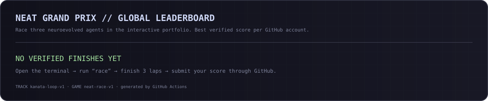

<p align="center">
  <a href="https://raw.githack.com/arman-dogru/arman-dogru/main/index.html">
    
  </a>
</p>

<p align="center">
  <a href="https://raw.githack.com/arman-dogru/arman-dogru/main/index.html"></a>
  <a href="https://www.linkedin.com/in/arman-dogru/"></a>
  <a href="https://scholar.google.com/citations?user=BUeifBIAAAAJ"></a>
</p>

<p align="center">
  <b>Applied AI Researcher @ Nokia Bell Labs</b><br/>
  Digital Twins · Computer Vision · Multi-Agent RL · Agentic Systems · Wireless Simulation
</p>

---

## `./portfolio`

The companion site is a working terminal-style portfolio rather than a decorative landing page. It contains:

- a tmux / neovim-inspired shell for navigating my work;
- an **OpenStreetMap-based career journey** with satellite mode and event dossiers describing what I built, achieved, and learned at each stop;
- public project launchers and research notes;
- a tightly scoped **Grok portfolio Q&A** relay that never exposes the API key in the browser;
- **NEAT Grand Prix v3** — a 10-car browser race against nine retrained neuroevolved drivers, with slower raceable handling, braking/reverse, recoverable collisions, grass/runoff, controllable slip, and steering calibrated by a fixed-budget evolutionary sweep.

```text
help
journey
trace huawei
projects
research
race
leaderboard
chat what did Arman work on at Bell Labs?
```

<p align="center">
  <a href="https://raw.githack.com/arman-dogru/arman-dogru/main/index.html">
    
  </a>
</p>

---

## `./neat_gp --track istanbul`

The default race is **Intercity Istanbul Park**. The selectable circuit layouts are sourced from the MIT-licensed `bacinger/f1-circuits` GeoJSON dataset: Istanbul Park, Monza, Spa-Francorchamps, and Monaco. Istanbul Park is pinned locally so the browser game and the training harness use the same centerline geometry.

The paved road remains deliberately fixed at **3.5 car widths**, but v3 uses a larger simulation world and separates asphalt from grass/runoff and the outer collision boundary. The 120 Hz vehicle model works in longitudinal/lateral velocity coordinates: throttle, braking and reverse are distinct, steering authority decreases with speed, lateral velocity is damped rather than snapped to the body heading, sliding/steering scrub speed, grass slows the car aggressively, and outer-barrier collisions preserve enough inward motion to recover instead of gluing the car to the wall. Car-to-car contact still uses oriented-body collision resolution with linear and angular impulses.

Steering was calibrated by training the same 24-controller × 10-generation residual population across ten physics configurations. The selected setup (`responsive-fine-b`) materially increased low/high-speed steering authority while staying stable in pack racing. The final full-NEAT retrain produced nine champions that each covered roughly **2.20–2.23 laps in 70 seconds with zero wall contacts**. In the 100-second nine-agent pack simulation they covered **2.327–2.632 laps**, averaged **2.452 laps**, recorded **one total wall contact**, and **0/9** ended stuck in recovery.

[Steering sweep and benchmark table →](./STEERING_SWEEP.md)  
[Race / training notes →](./NEAT_RACE.md)

Global leaderboard competition is intentionally limited to Istanbul Park so scores remain comparable. v3 resets the board because the physics, grid size, track identifier, and score formula are incompatible with v2 results. Display names are validated server-side with Unicode normalization, a character allowlist, length/repetition checks, private content filtering, reserved-name checks, and HTML escaping before they reach the profile SVG. The moderation vocabulary is supplied only through the `PROFANITY_BLOCKLIST_GZ_B64` GitHub Actions secret and is not stored in this public repository.

---

## `cat research.md`

### Nokia Bell Labs — Applied AI Researcher `2026 → present`
Semantic edge-to-cloud digital twins for urban mobility, computer vision localization, guided attention, real-time scene reconstruction, and an accepted **IEEE GLOBECOM 2026** paper.

### Smart Connected Vehicles Innovation Centre / NEXTCONLAB — Applied AI Researcher `2026`
Autonomous multi-agent systems using drones/UGVs, computer vision localization, **MARL/MAPF**, and RF geolocation from phase-difference-of-arrival measurements.

### Huawei Canada — Applied AI Researcher `2025`
Developed **PANAMA**, a network-aware MARL framework for multi-agent path finding in digital-twin environments. Also developed a multi-agent LLM reliability approach for hallucination detection/mitigation that resulted in a **U.S. patent filing (pending)**. First-author work accepted at **IEEE GLOBECOM 2025**.

---

## `ls ./featured-projects`

| Project | What it is |
|---|---|
| **[Ottawa Sionna RT Cellular Digital Twin](https://github.com/arman-dogru/Sionna_Canada_Testbed)** | Reproducible outdoor cellular-propagation digital twin built from public Ottawa geometry, terrain, spectrum-site data, NVIDIA Sionna RT, APIs, and a browser engineering UI. |
| **[Skate 3 Rust — macOS Apple Silicon](https://github.com/arman-dogru/skate3-rust-MacOS)** | Native ARM64 macOS port/continuation of the open-source Skate 3 Rust Engine using Rust, Bevy, SDL3, Metal, and Apple Silicon CI. |
| **[GSANet-DCNN](https://github.com/arman-dogru/GSANet-DCNN)** | Guided slot-attention architecture for unsupervised video object segmentation using spatial, temporal, and optical-flow information. |
| **[Developer Performance Tracker](https://github.com/arman-dogru/ai-powered-developer-productivity-dashboard)** | LLM-assisted GitHub engineering analytics for pull-request review, developer analysis, and productivity dashboards. |
| **[One-Pixel Adversarial Attack](https://github.com/arman-dogru/one-pixel-attack-2025)** | Black-box adversarial attacks against image classifiers using differential evolution. |
| **[LLM Bias Reduction](https://github.com/arman-dogru/LLM-Bias-Reduction)** | Fairness evaluation and bias-reduction experiments across LLM and traditional classification pipelines. |

---

## `cat publications.txt`

- **Semantic Edge-Cloud Communication for Real-Time Urban Traffic Digital Twins** — Nokia Bell Labs — **IEEE GLOBECOM 2026**, accepted.
- **PANAMA: A Network-Aware MARL Framework for Multi-Agent Path Finding in Digital Twin Ecosystems** — Huawei Canada — **IEEE GLOBECOM 2025**.
- **Methods and Apparatus For Detecting and Mitigating Hallucinations in Autonomous Multi-Agent Systems** — Huawei Canada — **U.S. patent pending**.

---

## `cat race-leaderboard.svg`

<p align="center"></p>

---

<p align="center"><code>Build systems that still work after the demo.</code></p>