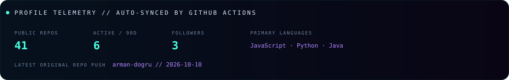

  

  
  
  

  <b>Digital Twins</b> · <b>Edge Intelligence</b> · <b>Computer Vision</b> · <b>Multi-Agent RL</b> · <b>Agentic LLM Systems</b>

---

## `whoami`

I am an **Applied AI Researcher at Nokia Bell Labs** and an M.Sc. Computer Science candidate at the **University of Ottawa**, specializing in AI. My work sits at the boundary between machine learning and physical systems: semantic edge-to-cloud digital twins, computer vision, wireless simulation, multi-agent reinforcement learning, and reliable multi-agent LLM workflows.

The recurring theme is simple: **make intelligent systems operate under real constraints — latency, bandwidth, uncertainty, coordination, and imperfect observations.**

<table>
<tr>
<td width="25%"><b>&gt;99.9%</b> data reduction in semantic edge-cloud digital-twin research</td>
<td width="25%"><b>0.12 m</b> mean vehicle-coordinate error in a vision localization pipeline</td>
<td width="25%"><b>256 agents</b> MARL/MAPF warehouse-scale experiments</td>
<td width="25%"><b>2× IEEE GLOBECOM</b> accepted papers in 2025 and 2026</td>
</tr>
</table>

---

## `launch --wasm`

  
  &nbsp;
  

**A zero-backend browser experiment built specifically for this profile:** a C kernel compiled to WebAssembly evolves **2,048 synthetic agents** while the browser renders the field in real time. Move the pointer to perturb the simulation and watch the measured WASM step time update live. The module is about **1.6 KB** and all simulation compute happens client-side.

> The telemetry-reduction numbers inside the demo are explicitly synthetic/illustrative; they are not measurements from Bell Labs research.

---

## `research --current`

### Nokia Bell Labs — Applied AI Researcher `2026 → present`
Building semantic **edge-to-cloud digital twins** for urban mobility: camera-to-semantic representations, real-time reconstruction in physics simulation, guided-attention foreground separation, object localization, homography, and Kalman filtering. Current work includes an accepted **IEEE GLOBECOM 2026** paper.

### Smart Connected Vehicles Innovation Centre / NEXTCONLAB — Applied AI Researcher `2026`
Worked on autonomous multi-agent systems using drones/UGVs, computer vision localization, **MARL/MAPF**, and RF geolocation using phase-difference-of-arrival measurements with ML/RL.

### Huawei Canada — Applied AI Researcher `2025`
Developed **PANAMA**, a network-aware MARL framework for multi-agent path finding in digital-twin environments. Also developed a multi-agent LLM reliability approach for hallucination detection/mitigation that resulted in a **U.S. patent filing (pending)**. First-author work was accepted at **IEEE GLOBECOM 2025**.

---

## `ls ./featured-projects`

| Project | What it does | Core stack |
|---|---|---|
| **[Ottawa Sionna RT Cellular Digital Twin](https://github.com/arman-dogru/Sionna_Canada_Testbed)** | Reproducible outdoor cellular-propagation digital twin using public Ottawa geometry, terrain, spectrum-site data, ray tracing, APIs, and a browser engineering UI. The current public build documents a 4×4 km multi-band demonstration with 14K+ buildings and 576 completed GPU jobs. | Python · NVIDIA Sionna RT · CUDA · FastAPI · React · MapLibre/deck.gl |
| **[Skate 3 Rust — macOS Apple Silicon](https://github.com/arman-dogru/skate3-rust-MacOS)** | Native ARM64 macOS port/continuation of the open-source Skate 3 Rust Engine, with Metal rendering, SDL3 input, native Rust crates, and Apple Silicon CI. | Rust · Bevy · SDL3 · Metal · GitHub Actions |
| **[GSANet-DCNN](https://github.com/arman-dogru/GSANet-DCNN)** | Guided slot-attention architecture for unsupervised video object segmentation using spatial, temporal, and optical-flow information. | PyTorch · Slot Attention · RAFT · Transformers · KNN filtering |
| **[Developer Performance Tracker](https://github.com/arman-dogru/ai-powered-developer-productivity-dashboard)** | LLM-assisted GitHub engineering analytics: automated PR review, developer analysis, and productivity dashboards. | React · Node.js · Express · MongoDB · GitHub OAuth · LLM APIs |
| **[One-Pixel Adversarial Attack](https://github.com/arman-dogru/one-pixel-attack-2025)** | Black-box adversarial attacks against image classifiers using differential evolution. | TensorFlow/Keras · CIFAR-10 · Differential Evolution |
| **[LLM Bias Reduction](https://github.com/arman-dogru/LLM-Bias-Reduction)** | Fairness evaluation and bias-reduction experiments across LLM/traditional classification pipelines and multiple datasets. | Python · LLMs · Fair-SMOTE/SMOTE · Random Forest · SVM |

Forks and upstream continuations are described as such rather than presented as original projects.

---

## `cat publications.txt`

- **Semantic Edge-Cloud Communication for Real-Time Urban Traffic Digital Twins** — Nokia Bell Labs — **IEEE GLOBECOM 2026**, accepted.
- **PANAMA: A Network-Aware MARL Framework for Multi-Agent Path Finding in Digital Twin Ecosystems** — Huawei Canada — **IEEE GLOBECOM 2025**.
- **Methods and Apparatus For Detecting and Mitigating Hallucinations in Autonomous Multi-Agent Systems** — Huawei Canada — **U.S. patent pending**.

---

## `tail -f /var/log/profile`

  

This card is generated from the public GitHub API by a scheduled **GitHub Actions** workflow and committed only when the underlying profile data changes.

---

## `stack --signal-only`

  

**ML / AI:** PyTorch · TensorFlow · CUDA · Hugging Face · Computer Vision · Reinforcement Learning / MARL · RAG · Multi-agent systems  
**Systems / Infra:** Docker · Azure · Linux · REST APIs · FastAPI · GitHub Actions · MongoDB · Supabase  
**Languages:** Python · C/C++ · Rust · Java · Kotlin · JavaScript/TypeScript · SQL

---

  <code>Build systems that still work after the demo.</code>

